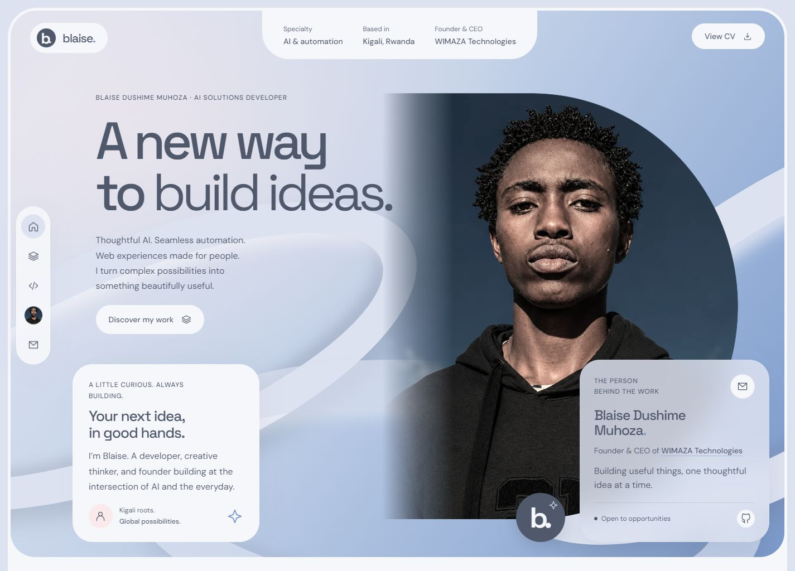

<div align="center">

# Blaise Dushime Muhoza

**AI Solutions Developer · Founder & CEO, WIMAZA Technologies**

Building useful products with AI, workflow automation, and modern web technologies.<br/>
Based in Kigali, Rwanda. Open to collaboration worldwide.

[Live portfolio](https://viper-one-pink.vercel.app/) · [WIMAZA Technologies](https://wimaza.vercel.app/) · [LinkedIn](https://www.linkedin.com/in/ukomeye/) · [View CV](https://pdfhost.io/v/eD8pKwPAVc_DMB_CV) · [Get in touch](mailto:bdushime34@gmail.com)

[](https://github.com/mantis-rei/web-repo/actions/workflows/deploy.yml)

</div>



## The portfolio

A responsive portfolio built with **Astro and TypeScript**, featuring seven dedicated project pages, real product previews, and a visual identity in powder blue, slate, and blush. The portrait's D-shaped frame fades along its straight edge while keeping the arc crisp, alongside a fully rounded profile card.

Content is rendered as static HTML, with unique page metadata, social previews, structured data, and a sitemap. Local fonts, optimized images, accessible navigation, and reduced-motion support keep the experience considered across desktop and mobile.

## Selected projects

| Project | Focus | Explore |
| --- | --- | --- |
| **Easy Fine-Tuner** | Open-source model training with Python, Hugging Face, and LoRA | [Source](https://github.com/mantis-rei/Easy-fineTuner) |
| **Pezaas** | An Astro-based social media services platform for Rwanda | [Live website](https://pezaas.vercel.app/) |
| **OutreachHub** | A React workspace for lead generation and customer outreach | [Live website](https://outreachhub-dc64f.web.app/) |
| **VEO Stream** | A Python and API-based cinematic video generation experience | Featured in the portfolio |
| **Kora Architect** | Hand-drawn floorplans to editable parametric 3D models with Rwanda-style roofs | [Repository](https://github.com/mantis-rei/Kora-Architect) |
| **MAZA TTS** | CPU-based speech generation exploration, based on Kyutai’s Pocket TTS | [Repository](https://github.com/mantis-rei/pocket-tts-by-Viper) · [Upstream](https://github.com/kyutai-labs/pocket-tts) |
| **Study Craft AI** | Guided, step-by-step learning built with React and JavaScript | [Live website](https://study-craft-ai-seven.vercel.app/) · [Source](https://github.com/mantis-rei/Study-Craft-AI) |

Pezaas and OutreachHub use supplied website screenshots. Other project visuals are presentation illustrations, identified on their detail pages. MAZA TTS is presented as an open-source exploration with its Pocket TTS foundation credited.

## Run locally

Use Node.js 24, then:

```sh
npm ci
npm run dev
```

Open [the local portfolio](http://127.0.0.1:4321/web-repo/).

```sh
npm run build
npm run verify
```

The build checks Astro and TypeScript. Verification covers generated pages, local links and assets, metadata, project destinations, and the sitemap.

## Development and deployment

The same Astro source powers every deployment. Publish the generated `dist` directory to use the current design; the root `Index.html` is a preserved legacy reference.

The portfolio is live on Vercel at **[viper-one-pink.vercel.app](https://viper-one-pink.vercel.app/)**. The GitHub-linked Vercel project builds the same Astro source and publishes `dist`.

See the [development and deployment guide](docs/DEVELOPMENT.md) for hosting configuration, content editing, and project structure.
